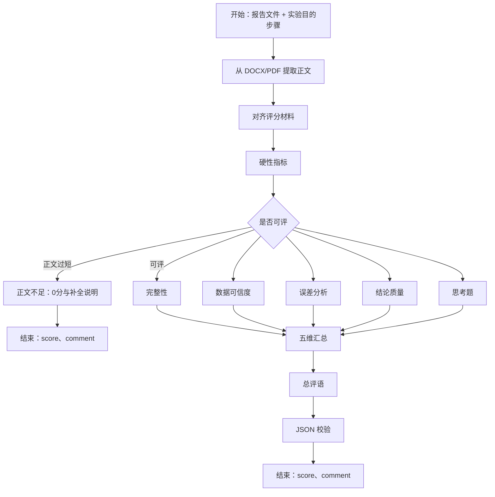

# 物小智 · 教师报告预评（Dify 工作流）

对应 DSL：`docs/dify/物小智-教师报告预评.yml`（由 `scripts/build_report_review_dify.py` 生成）

这是**教师端**「报告分析 → AI 预评」专用 **Workflow**，使用100分制，不要和学生端「报告助手」混用。

## 1. 生成最新 DSL

修改提示词或节点后执行：

```bash
python scripts/build_report_review_dify.py
```

生成文件：

- `docs/dify/物小智-教师报告预评.yml`

## 2. 导入 Dify 并发布

1. 打开 Dify **工作室** → **导入 DSL**
2. 选择 `docs/dify/物小智-教师报告预评.yml`
3. 原应用为 Chatflow 时，请新建 Workflow 应用导入；不要继续使用旧 Chatflow 的 API Key。
4. 确认模型为已配置的通义 `qwen-plus`（与现有报告助手相同）
5. **发布** → 访问 API → 复制 API Key（`app-...`）

## 3. 写入后端配置

编辑 `config/dify.env`：

```env
DIFY_WF_REPORT_REVIEW=app-你的预评Key
```

**不要**把学生端 `DIFY_WF_REPORT_ASSIST` 填到这里。未配置时，教师端预评会提示工作流未接入，而不会再悄悄走学生报告助手。

后端单独将 `report-review` 配置为 `workflow`，请求 `POST /workflows/run`；其他对话智能体仍沿用各自模式，不需要修改全局 `DIFY_APP_MODE`。

旧Chatflow的Key不能视为已经部署了新Workflow。文件导入并发布后，必须将新Workflow应用的Key写入上面的配置。

重启后端：`scripts/run-backend.bat`

## 4. 工作流节点（有分叉，不是一条线）



| 节点 | 作用 |
|------|------|
| 开始 | 两个主输入：学生报告**文件**、本实验**目的与步骤** |
| 文档提取 | 把 DOCX/PDF 转成正文，供后续评分 |
| 硬性指标 | 字数、章节痕迹、风险；输出 `review_route` |
| 是否可评 | **IF/ELSE**：正文过短走 A，否则走 B |
| 分支 A | 不跑大模型，直接0分 + 补全说明，需教师确认 |
| 分支 B1–B5 | **五维并行**打分 |
| 汇总 / 总评 | 五个维度各20分，代码加总为100分，再生成教师评语；模型不能改写总分 |
| 结束 | 仅输出number类型的 `score` 与string类型的 `comment` |

## 5. 后端注入的变量

| Dify 变量 | 来源 |
|-----------|------|
| `student_report_file` | 学生报告 Word 文件（上传到 Dify） |
| `experiment_spec` | 本实验目的、原理要点、步骤、应测字段 |
| `experiment_name` | 实验名称 |
| `student_name` / `student_class` | 学生 |

Workflow API成功响应中 `data.outputs` 的内容示例：

```json
{
  "score": 76,
  "comment": "数据记录基本完整，建议补充不确定度计算与结果讨论。建议分需教师确认。"
}
```

`score` 为 **0至100的建议分**。`comment` 必须是非空字符串。结束节点不再返回JSON字符串、分档、评分维度或额外标志。

后端读取 `data.outputs.score` 和 `data.outputs.comment`，拒绝越界分数、空评语或失败的Workflow执行，不用默认分数代替失败结果。教师可修改分数及评语，点「完成批改」后才落档。

系统为历史成绩新增分制字段，旧记录按10分制保留，新预评及新批改按100分制保存；API和页面统一显示百分制。例如旧8/10显示80/100，新5/100仍显示5/100，不按数值大小猜测分制。

## 6. Dify 预览调试

在工作室测试运行中上传 `student_report_file`，填写 `experiment_spec`，可选填写实验名称、学生姓名和班级。成功后结果面板只有 `score` 和 `comment` 两项。不需要 `sys.query`、对话ID或聊天消息。

本地检查DSL、变量引用及评分代码：`python scripts/check_report_review_workflow.py`（需要PyYAML）。

预评主路径含 5 个并行 LLM + 1 次总评，大约 20–50 秒，属正常。空报告会走短路，几乎立刻返回。

## 常见问题

| 现象 | 处理 |
|------|------|
| 页面提示工作流未接入 | `DIFY_WF_REPORT_REVIEW` 为空或仍是学生助手 Key |
| 有评语没分数 | 检查结束节点 `score` 是否引用 `format.score`，`comment` 是否引用 `format.comment` |
| API提示应用类型不匹配 | 将 `DIFY_WF_REPORT_REVIEW` 改成新Workflow应用的Key，重启后端 |
| 导入后模型报错 | 把各 LLM 节点模型改成你工作室里已启用的通义模型 |
| 请求超时 | 前端已放宽到 180 秒；若仍超时，在 Dify 看哪一维 LLM 卡住 |
